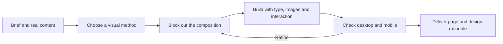

# Web Design Skill for AI Agents

**Ten visual methods. Ten interactive websites. Give your content a distinctive composition.**

[中文说明](README.zh-CN.md) · [Skill instructions](SKILL.md) · [Interactive gallery setup](#try-the-gallery)


Turn a brief into a distinctive composition, organize the real content, and build a working page. Use this skill for brand websites, campaign pages, product landing pages and redesigns.

- **Composition before decoration:** choose a carrier, a dominant shape, a crop or a reading path that actually organizes the content.
- **Ten practical methods:** each includes when to use it, concrete design moves, common mistakes and checks.
- **Inspectable examples:** ten responsive HTML/CSS/JS concepts, desktop and mobile screenshots, layout skeletons, source files and repeatable browser checks.

Contents: [How it works](#how-it-works) · [Install](#install) · [Examples](#examples) · [Development](#development) · [Use](#use) · [Inside](#whats-inside) · [Contribute](#contribute)

## How it works



The main method changes the structure of the page. Supporting methods clarify hierarchy and details. The skill adapts to the existing project and its design system; strong campaign visuals are used where they serve the task.

The skill contains instructions and references. The agent supplies the coding, image and browser tools. New artwork requires an available image tool or supplied assets; no image service or API key is bundled. The skill instructions are currently written in Chinese. The demonstrations include generated artwork and iterative feedback, so tool access, assets and the brief affect the result.

## Install

Clone this repository and open its folder:

```sh
git clone https://github.com/jseanj/web-design-skill.git
cd web-design-skill
```

Then run one of these installation commands. Python 3 is needed only for the helper; installation copies the skill instructions, four references, Codex UI metadata and license. It does not copy the gallery or its images.

| Agent | Install command | Default destination |
| --- | --- | --- |
| Codex | `python3 scripts/install_skill.py --target codex` | `~/.codex/skills/web-design-skill/` |
| Claude Code | `python3 scripts/install_skill.py --target claude` | `~/.claude/skills/web-design-skill/` |
| Gemini CLI | `python3 scripts/install_skill.py --target gemini` | `~/.gemini/skills/web-design-skill/` |

The helper refuses to overwrite a different existing installation. To use a custom or project-specific location, pass the complete destination folder:

```sh
python3 scripts/install_skill.py --destination /path/to/skills/web-design-skill
```

You can also copy `SKILL.md`, `references/`, `agents/` and `LICENSE` into a `web-design-skill/` folder yourself. See the official [Claude Code skill locations](https://code.claude.com/docs/en/skills#choose-where-skills-load) and [Gemini CLI skill locations](https://geminicli.com/docs/cli/using-agent-skills/). Platform installation paths are supported by the helper; end-to-end generation has not been tested separately across all three agents.

Start a new agent session after installation. In Codex, invoke `$web-design-skill`; in Claude Code, use `/web-design-skill`; in Gemini CLI, describe the task and ask it to use `web-design-skill`.

To create a small, portable skill archive:

```sh
python3 scripts/package_skill.py
# dist/web-design-skill.zip
```

Unzip it into the skills directory used by your agent. There is no runtime dependency in the installed skill.

## Examples

Ten fictional concept websites show how the methods organize real page content. Each comes with a design breakdown and a prompt you can adapt. The examples were developed through iteration and feedback, with generated artwork where needed.

| # | Brand / context | Main method | Structural move |
| --- | --- | --- | --- |
| 01 | [ORIGIN CLUB — Coffee subscription](docs/case-studies/coffee-passport.md) | Borrow from real objects · 抄现实 | Coffee pouch as content carrier |
| 02 | [OFF / GRID — Design festival](docs/case-studies/offgrid-festival.md) | Compose with geometry · 圆、方、三角 | Circle / date; square / programme; triangle / entry |
| 03 | [APERTURE — Camera lens](docs/case-studies/aperture-lens.md) | Frame a revealing fragment · 断臂之美 | Eye, hand and lens crop |
| 04 | [SŌL — Independent fragrance](docs/case-studies/sol-fragrance.md) | Create emphasis through restraint · 欲擒故纵 | White space and a continuous line |
| 05 | [SHIFT — Urban running club](docs/case-studies/shift-running.md) | Shift the composition · 乾坤大挪移 | A tilted route ticket |
| 06 | [FIELD NOTES — Architecture magazine](docs/case-studies/field-notes.md) | Build editorial rhythm · 杂志版式 | Cover-scale editorial hierarchy |
| 07 | [NORTH / 向野 — Outdoor travel](docs/case-studies/north-travel.md) | Design a full-bleed view · 全屏大视野 | Full-bleed landscape with safe text |
| 08 | [开物 KAIWU — Pottery workshop](docs/case-studies/kaiwu-workshop.md) | Organize the text wardrobe · 文字衣橱 | Folded sheets and consistent facts |
| 09 | [LOOP / 循杯 — Reuse-program explainer](docs/case-studies/loop-impact.md) | Visualize relationships · 你看起来很好吃 | A closed loop and inspectable math |
| 10 | [CRUMB / 一点屑 — Handmade bakery](docs/case-studies/crumb-bakery.md) | Add purposeful details · 钉钉铆铆 | Notes and details with a purpose |

### 01 · ORIGIN CLUB — Coffee subscription

**Brief:** Make a subscription feel like a journey through coffee origins.


**Design decision:** A warm orange coffee pouch becomes the content carrier. Live HTML on its label holds the origin, tasting notes and roast profile; three origin choices update the same package. The cream canvas keeps attention on the product.

[Design breakdown & prompt](docs/case-studies/coffee-passport.md) · [Full page](docs/previews/coffee-passport-full.jpg) · [Mobile](docs/previews/coffee-passport-mobile.png) · [Layout skeleton](docs/previews/coffee-passport-skeleton.jpg) · [HTML source](docs/examples/coffee-passport/index.html)

### 02 · OFF / GRID — Design festival

**Brief:** Give a design festival a bold graphic identity and an agenda people can use.


**Design decision:** Oversized typography anchors a geometric poster. A fluorescent circle selects the day, a black square holds the changing programme, and a pink triangle is the entry button. The shapes organize the real content.

[Design breakdown & prompt](docs/case-studies/offgrid-festival.md) · [Full page](docs/previews/offgrid-festival-full.jpg) · [Mobile](docs/previews/offgrid-festival-mobile.png) · [Layout skeleton](docs/previews/offgrid-festival-skeleton.jpg) · [HTML source](docs/examples/offgrid-festival/index.html)

### 03 · APERTURE — Camera lens

**Brief:** Communicate the intimacy of photography without a conventional product packshot.


**Design decision:** One eye, a hand and a tightly cropped lens carry the image. A red specification strip anchors the composition; an aperture control changes the iris.

[Design breakdown & prompt](docs/case-studies/aperture-lens.md) · [Full page](docs/previews/aperture-lens-full.jpg) · [Mobile](docs/previews/aperture-lens-mobile.png) · [Layout skeleton](docs/previews/aperture-lens-skeleton.jpg) · [HTML source](docs/examples/aperture-lens/index.html)

### 04 · SŌL — Independent fragrance

**Brief:** Turn a small amount of fragrance copy into a slow, continuous reading experience.


**Design decision:** A winding line connects three numbered scent moments across generous white space. Watercolor flowers set the rhythm before the final blue perfume section.

[Design breakdown & prompt](docs/case-studies/sol-fragrance.md) · [Full page](docs/previews/sol-fragrance-full.jpg) · [Mobile](docs/previews/sol-fragrance-mobile.png) · [Layout skeleton](docs/previews/sol-fragrance-skeleton.jpg) · [HTML source](docs/examples/sol-fragrance/index.html)

### 05 · SHIFT — Urban running club

**Brief:** Make a running-club signup page feel energetic while keeping route facts readable.


**Design decision:** The whole route ticket tilts, carrying its distance, details and call to action together. An orange runner overlaps the ticket to establish depth.

[Design breakdown & prompt](docs/case-studies/shift-running.md) · [Full page](docs/previews/shift-running-full.jpg) · [Mobile](docs/previews/shift-running-mobile.png) · [Layout skeleton](docs/previews/shift-running-skeleton.jpg) · [HTML source](docs/examples/shift-running/index.html)

### 06 · FIELD NOTES — Architecture magazine

**Brief:** Give architecture stories the pace and visual hierarchy of a magazine cover.


**Design decision:** A red masthead, image-spanning type, an oversized issue number and narrow text columns create a deliberate rhythm around the building photograph.

[Design breakdown & prompt](docs/case-studies/field-notes.md) · [Full page](docs/previews/field-notes-full.jpg) · [Mobile](docs/previews/field-notes-mobile.png) · [Layout skeleton](docs/previews/field-notes-skeleton.jpg) · [HTML source](docs/examples/field-notes/index.html)

### 07 · NORTH / 向野 — Outdoor travel

**Brief:** Let the landscape lead without losing trip details or the next action.


**Design decision:** A full-bleed mountain landscape establishes scale. Large type, a route line and a compass sit in separate safe information layers; departure options change the details.

[Design breakdown & prompt](docs/case-studies/north-travel.md) · [Full page](docs/previews/north-travel-full.jpg) · [Mobile](docs/previews/north-travel-mobile.png) · [Layout skeleton](docs/previews/north-travel-skeleton.jpg) · [HTML source](docs/examples/north-travel/index.html)

### 08 · 开物 KAIWU — Pottery workshop

**Brief:** Make a dense workshop brief easy to scan without dropping practical conditions.


**Design decision:** Three folded sheets express the learning sequence. Consistent fact labels, expandable sessions and one booking ticket organize the details.

[Design breakdown & prompt](docs/case-studies/kaiwu-workshop.md) · [Full page](docs/previews/kaiwu-workshop-full.jpg) · [Mobile](docs/previews/kaiwu-workshop-mobile.png) · [Layout skeleton](docs/previews/kaiwu-workshop-skeleton.jpg) · [HTML source](docs/examples/kaiwu-workshop/index.html)

### 09 · LOOP / 循杯 — Reuse-program explainer

**Brief:** Explain how a reusable-cup program works, then make the arithmetic inspectable.


**Design decision:** A cup character, four stations and a closed pipe show the loop. A separate calculator uses weekly frequency × 52 and bars with a shared scale.

[Design breakdown & prompt](docs/case-studies/loop-impact.md) · [Full page](docs/previews/loop-impact-full.jpg) · [Mobile](docs/previews/loop-impact-mobile.png) · [Layout skeleton](docs/previews/loop-impact-skeleton.jpg) · [HTML source](docs/examples/loop-impact/index.html)

### 10 · CRUMB / 一点屑 — Handmade bakery

**Brief:** Give a bakery catalog a handmade voice and a clear selection flow.


**Design decision:** Tape, a postmark, handwritten notes and numbered flavor cards support the selection. Toggle the embellishments to inspect their contribution to the same layout.

[Design breakdown & prompt](docs/case-studies/crumb-bakery.md) · [Full page](docs/previews/crumb-bakery-full.jpg) · [Mobile](docs/previews/crumb-bakery-mobile.png) · [Layout skeleton](docs/previews/crumb-bakery-skeleton.jpg) · [HTML source](docs/examples/crumb-bakery/index.html)

## Try the gallery

Open `docs/index.html` directly, or serve the self-contained gallery from the repository root:

```sh
python3 -m http.server 8765 --bind 127.0.0.1 --directory docs
```

Visit [localhost:8765](http://127.0.0.1:8765). All ten examples have working controls, a design explanation and a layout-skeleton toggle. The bakery example also has a decoration toggle.

The gallery runs without Node, a build step or external assets. GitHub displays the HTML links as source files; use the local gallery for the interactive experience. A manual GitHub Pages workflow is included to publish the static gallery after Pages is enabled.

## Development

<details>
<summary>Run checks or update the examples</summary>

Check local links and the skill's identity:

```sh
python3 scripts/check_repo.py
```

For browser checks, install Node.js 20+ and the development dependencies. Start the gallery server in a separate terminal, then run:

```sh
npm install
npx playwright install chromium
npm run verify
```

The browser script checks loading, horizontal overflow and primary interactions at 1440, 768 and 390 px. It updates `docs/previews/` and the [browser report](docs/verification.json). CI runs the same checks and saves the results as artifacts.

Edit page markup in `scripts/build-examples.py`, then run `npm run render`. Case descriptions and prompts live in `docs/cases.js`; keep the corresponding design breakdown in sync. To rebuild the overview image, install Pillow and run:

```sh
python3 -m pip install Pillow
python3 scripts/overview.py
```

Fonts may render differently across operating systems. Browser checks verify behavior; review the visual result too.

</details>

## Use

Provide the product, audience, intended action, actual copy and available assets. The agent should work with the project's existing stack and preserve essential information.

```text
Use $web-design-skill to design and build a landing page.
Product: a monthly specialty-coffee subscription.
Audience: curious home brewers.
Primary action: choose an origin and explore the subscription.
Content and assets: [attach the real brief, copy and images].
Choose a method that makes the content part of the composition.
Check the desktop and mobile versions and explain the key decisions.
```

For a focused redesign:

```text
Use $web-design-skill's text-organization method to redesign this workshop page.
Keep the date, price, eligibility and cancellation conditions.
Make the hierarchy clear, then implement the revised page.
```

For art direction only:

```text
Use web-design-skill to propose three structurally different directions
for this festival page. Compare the carrier, dominant shape and reading path.
Recommend one direction. Deliver concepts only; do not write code yet.
```

Replace the Codex invocation with the form supported by your agent. A detailed brief and usable images improve the result; the skill does not guarantee the appearance of these particular examples.

## What's inside

```text
SKILL.md                         Core workflow and method selection
agents/openai.yaml               Codex display name and invocation metadata
references/
  visual-methods.md              Ten methods, concrete moves and pitfalls
  implementation.md             Responsive implementation and visual checks
  examples.md                   Method-transfer examples
  campaign-composition.md       Strong campaign compositions and content carriers
docs/
  index.html                    Interactive showcase
  examples/                     Ten complete HTML pages
  case-studies/                 Design breakdowns and example prompts
  assets/                       Shared CSS/JS and eight generated images
  previews/                     Desktop, mobile and skeleton captures
  verification.json             Saved browser-check results
scripts/                        Install, package, render and verify helpers
.github/workflows/              CI and manual Pages publication
```

## Contribute

Issues and pull requests are welcome in English or Chinese. Include a concrete brief or problem, the change and screenshots where useful. For page changes, follow the development steps above and check desktop and mobile. Document the source of new assets and any additional dependencies.

All demonstration brands, activities, prices, product specifications and business data are fictional. The pages do not process purchases, payments or registrations. Eight AI-generated images are included, with prompts in the [asset record](docs/assets/art-prompts.json); they are not documentary photographs of real projects or destinations.

## License

[MIT](LICENSE). The license applies to the repository's code, documentation and included generated artwork, to the extent rights can be granted. No third-party reference screenshots are included.
