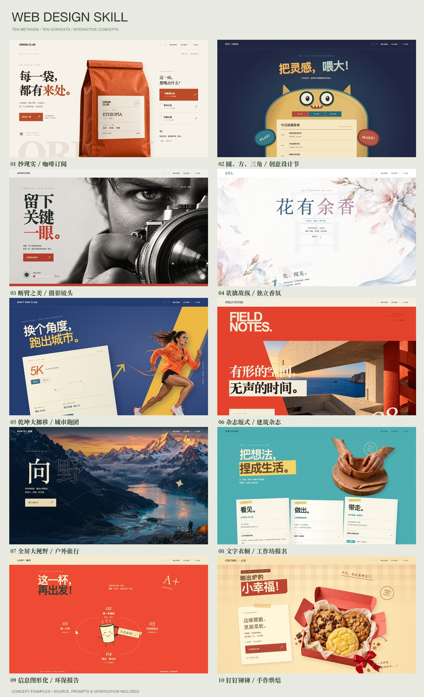
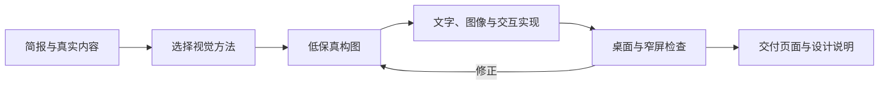
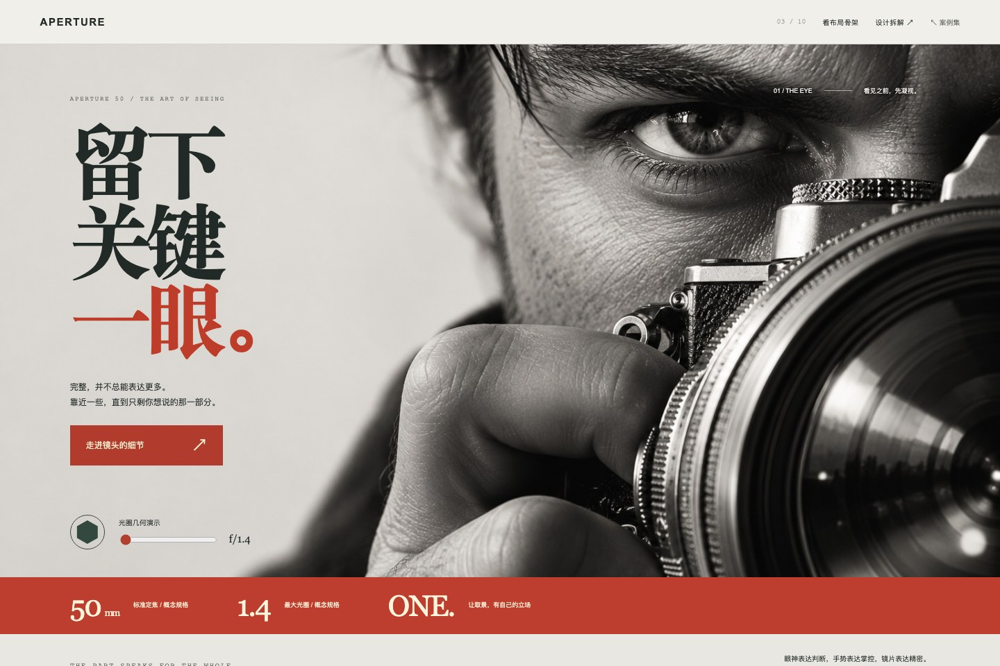
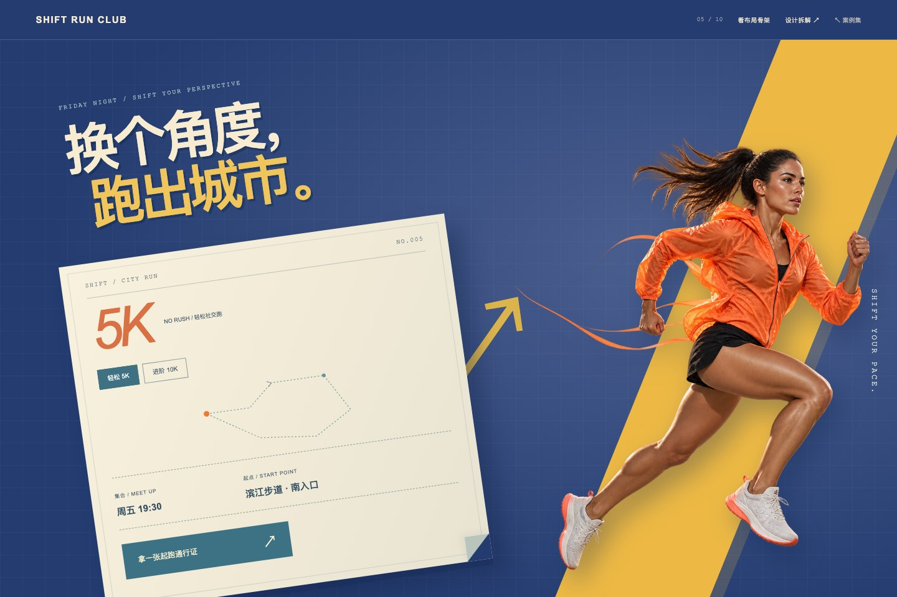
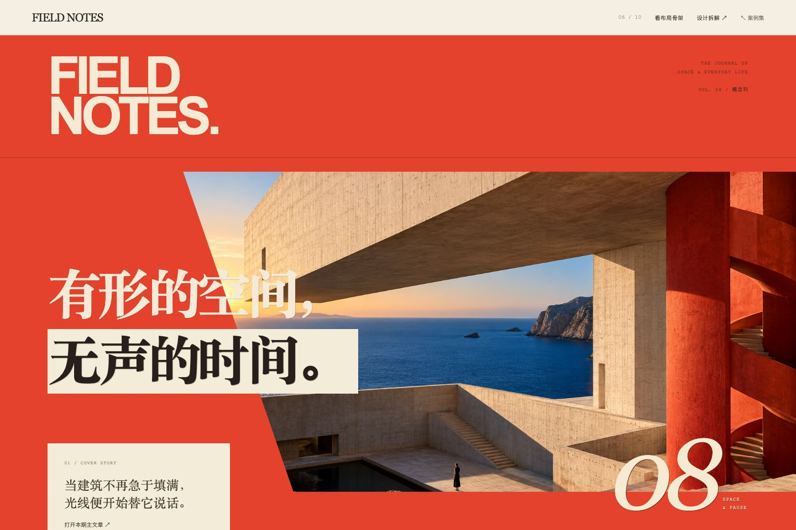
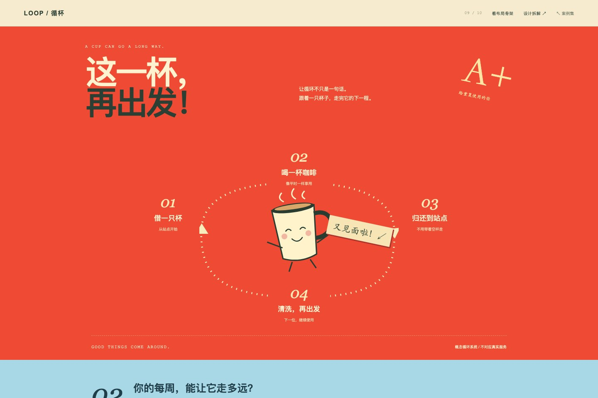

# Web Design Skill · 网页视觉设计

**十种视觉方法，十个可交互网页，一套能检查设计过程的 Skill。**

[English](README.md) · [技能入口](SKILL.md) · [复现协议](docs/REPRODUCIBILITY.md)



把主题变成有辨识度的构图，整理真实内容，再完成能运行的页面。适用于品牌官网、活动专题、产品落地页与页面改版。

- **先构图，再装饰**：载体、主形、取景与阅读路线真正参与信息组织。
- **十种可操作的方法**：每种方法都有适用问题、具体动作、常见误区与检查方式。
- **可以查看，也可以操作**：十份响应式 HTML/CSS/JS 页面，附桌面、手机和布局骨架截图、源码与浏览器检查脚本。

目录：[工作方式](#工作方式) · [安装](#安装) · [十个案例](#十个案例) · [验证](#验证什么) · [使用](#使用) · [文件结构](#文件结构) · [贡献](#贡献与许可)

## 工作方式



主方法决定大结构，辅助方法处理层次与细节。沿用项目技术栈与设计系统，根据页面任务控制表现强度。

Skill 提供工作规则与参考文件，代码、图片和浏览器能力来自运行它的 AI 工具。生成新图片需要可用的生图工具或你提供的素材；安装包不附图片服务或 API 密钥。当前技能正文为中文。展示案例经过迭代反馈并使用生成素材，效果也受简报、素材和工具条件影响。

## 安装

克隆仓库并进入目录：

```sh
git clone https://github.com/jseanj/web-design-skill.git
cd web-design-skill
```

在仓库根目录运行以下任一安装命令。辅助脚本需要 Python 3；只安装技能入口、四份参考、Codex 界面元数据与许可文件，不复制案例集和图片。

| 工具 | 安装命令 | 默认位置 |
| --- | --- | --- |
| Codex | `python3 scripts/install_skill.py --target codex` | `~/.codex/skills/web-design-skill/` |
| Claude Code | `python3 scripts/install_skill.py --target claude` | `~/.claude/skills/web-design-skill/` |
| Gemini CLI | `python3 scripts/install_skill.py --target gemini` | `~/.gemini/skills/web-design-skill/` |

脚本拒绝覆盖内容不同的已有安装。自定义位置或项目目录可使用完整目标路径：

```sh
python3 scripts/install_skill.py --destination /path/to/skills/web-design-skill
```

也可以手动把 `SKILL.md`、`references/`、`agents/` 和 `LICENSE` 放入技能目录下的 `web-design-skill/`。目录规则可查阅 [Claude Code 官方说明](https://code.claude.com/docs/en/skills#choose-where-skills-load) 与 [Gemini CLI 官方说明](https://geminicli.com/docs/cli/using-agent-skills/)。脚本提供这些目录选项，尚未分别完成三个工具中的端到端生成验证。

安装后开启新会话。Codex 用 `$web-design-skill`，Claude Code 用 `/web-design-skill`，Gemini CLI 可直接要求使用 `web-design-skill` 完成任务。

生成轻量安装包：

```sh
python3 scripts/package_skill.py
# 输出 dist/web-design-skill.zip
```

将压缩包解压到对应工具的技能目录即可。安装后的技能无运行依赖。

## 十个案例

这些是一个创作会话读取技能后，经过反馈与修改完成的虚构概念网站。每例突出一种结构动作；原始需求、生成素材和后续技能改进也参与了结果，不能把它们当作独立实验。

| # | 场景 | 主方法 | 构图动作 |
| --- | --- | --- | --- |
| 01 | [ORIGIN CLUB / 咖啡订阅](docs/case-studies/coffee-passport.md) | 抄现实 | 咖啡豆袋承载产地信息 |
| 02 | [OFF / GRID / 创意设计节](docs/case-studies/offgrid-festival.md) | 圆、方、三角 | 圆形角色与方形议程 |
| 03 | [APERTURE / 摄影镜头](docs/case-studies/aperture-lens.md) | 断臂之美 | 单眼、手与镜片局部 |
| 04 | [SŌL / 独立香氛](docs/case-studies/sol-fragrance.md) | 欲擒故纵 | 留白与曲线形成连续阅读 |
| 05 | [SHIFT / 城市跑团](docs/case-studies/shift-running.md) | 乾坤大挪移 | 旋转整张路线票据 |
| 06 | [FIELD NOTES / 建筑杂志](docs/case-studies/field-notes.md) | 杂志版式 | 刊头、大字与窄栏节奏 |
| 07 | [NORTH / 向野 / 户外旅行](docs/case-studies/north-travel.md) | 全屏大视野 | 全幅山野与安全信息层 |
| 08 | [开物 KAIWU / 工作坊报名](docs/case-studies/kaiwu-workshop.md) | 文字衣橱 | 三折纸与统一字段 |
| 09 | [LOOP / 循杯 / 环保项目说明](docs/case-studies/loop-impact.md) | 你看起来很好吃 | 闭合循环与可核算数据 |
| 10 | [CRUMB / 一点屑 / 手作烘焙](docs/case-studies/crumb-bakery.md) | 钉钉铆铆 | 带有信息职责的小装饰 |

### 01 · ORIGIN CLUB / 抄现实

**简报：**把咖啡订阅变成一段产地旅程。


**设计决定：**以暖橙色咖啡豆袋为现实载体，袋身标签放入产地、风味与烘焙，三个产地选择更新同一包装。暖白底和深咖色大字让产品成为焦点。

[设计拆解与复现简报](docs/case-studies/coffee-passport.md) · [完整长页](docs/previews/coffee-passport-full.jpg) · [手机效果](docs/previews/coffee-passport-mobile.png) · [布局骨架](docs/previews/coffee-passport-skeleton.jpg) · [HTML 源码](docs/examples/coffee-passport/index.html)

### 02 · OFF / GRID / 圆、方、三角

**简报：**为创意设计节建立鲜明角色，同时让议程易读。


**设计决定：**圆形身体、三角耳朵和方形纸腹组成节日角色；议程进入纸腹，切换日期即可更新。

[设计拆解与复现简报](docs/case-studies/offgrid-festival.md) · [完整长页](docs/previews/offgrid-festival-full.jpg) · [手机效果](docs/previews/offgrid-festival-mobile.png) · [布局骨架](docs/previews/offgrid-festival-skeleton.jpg) · [HTML 源码](docs/examples/offgrid-festival/index.html)

### 03 · APERTURE / 断臂之美

**简报：**用摄影的观看情绪介绍镜头。



**设计决定：**单眼、握持动作与镜片特写构成主画面；红色参数带稳定重心，光圈控件改变可见的光圈结构。

[设计拆解与复现简报](docs/case-studies/aperture-lens.md) · [完整长页](docs/previews/aperture-lens-full.jpg) · [手机效果](docs/previews/aperture-lens-mobile.png) · [布局骨架](docs/previews/aperture-lens-skeleton.jpg) · [HTML 源码](docs/examples/aperture-lens/index.html)

### 04 · SŌL / 欲擒故纵

**简报：**让简短的香氛文案形成舒缓、连续的阅读体验。


**设计决定：**曲线穿过大片留白，串联三个带序号的香气时刻；水彩花枝控制节奏，最后进入蓝色香水选择区。

[设计拆解与复现简报](docs/case-studies/sol-fragrance.md) · [完整长页](docs/previews/sol-fragrance-full.jpg) · [手机效果](docs/previews/sol-fragrance-mobile.png) · [布局骨架](docs/previews/sol-fragrance-skeleton.jpg) · [HTML 源码](docs/examples/sol-fragrance/index.html)

### 05 · SHIFT / 乾坤大挪移

**简报：**让跑团报名页有动势，并保留清楚的路线信息。



**设计决定：**整张路线票据一起旋转，里程、详情和行动入口随它组织；橙色跑者叠入票据前方，建立空间关系。

[设计拆解与复现简报](docs/case-studies/shift-running.md) · [完整长页](docs/previews/shift-running-full.jpg) · [手机效果](docs/previews/shift-running-mobile.png) · [布局骨架](docs/previews/shift-running-skeleton.jpg) · [HTML 源码](docs/examples/shift-running/index.html)

### 06 · FIELD NOTES / 杂志版式

**简报：**让建筑内容拥有杂志封面的节奏与层级。



**设计决定：**红色刊头、跨图大字、超大期号与窄栏文字围绕建筑影像组织，文章入口可打开阅读。

[设计拆解与复现简报](docs/case-studies/field-notes.md) · [完整长页](docs/previews/field-notes-full.jpg) · [手机效果](docs/previews/field-notes-mobile.png) · [布局骨架](docs/previews/field-notes-skeleton.jpg) · [HTML 源码](docs/examples/field-notes/index.html)

### 07 · NORTH / 向野 / 全屏大视野

**简报：**让风景成为第一感受，同时保留行程信息与下一步。


**设计决定：**山野影像铺满视野；大字、路线与罗盘在独立信息层定位，出发时段可切换，窄屏重新安排安全区。

[设计拆解与复现简报](docs/case-studies/north-travel.md) · [完整长页](docs/previews/north-travel-full.jpg) · [手机效果](docs/previews/north-travel-mobile.png) · [布局骨架](docs/previews/north-travel-skeleton.jpg) · [HTML 源码](docs/examples/north-travel/index.html)

### 08 · 开物 KAIWU / 文字衣橱

**简报：**让信息密集的工作坊简报易于扫描，保留重要条件。


**设计决定：**三张折纸对应学习的三组任务；统一字段标签、可展开日程与底部报名票据整理信息层次。

[设计拆解与复现简报](docs/case-studies/kaiwu-workshop.md) · [完整长页](docs/previews/kaiwu-workshop-full.jpg) · [手机效果](docs/previews/kaiwu-workshop-mobile.png) · [布局骨架](docs/previews/kaiwu-workshop-skeleton.jpg) · [HTML 源码](docs/examples/kaiwu-workshop/index.html)

### 09 · LOOP / 循杯 / 你看起来很好吃

**简报：**先讲清循环杯的运行关系，再让计算过程可检查。



**设计决定：**杯子角色、四个站点与闭合管线表达循环；独立计算区按每周次数 × 52 更新，并用同尺度条形呈现。

[设计拆解与复现简报](docs/case-studies/loop-impact.md) · [完整长页](docs/previews/loop-impact-full.jpg) · [手机效果](docs/previews/loop-impact-mobile.png) · [布局骨架](docs/previews/loop-impact-skeleton.jpg) · [HTML 源码](docs/examples/loop-impact/index.html)

### 10 · CRUMB / 一点屑 / 钉钉铆铆

**简报：**为烘焙目录建立手作语气，并保持选购流程清楚。


**设计决定：**胶带、邮戳、手写批注和编号口味纸签辅助选择；装饰开关可检查同一结构中细节的作用。

[设计拆解与复现简报](docs/case-studies/crumb-bakery.md) · [完整长页](docs/previews/crumb-bakery-full.jpg) · [手机效果](docs/previews/crumb-bakery-mobile.png) · [布局骨架](docs/previews/crumb-bakery-skeleton.jpg) · [HTML 源码](docs/examples/crumb-bakery/index.html)

## 运行案例集

直接打开 `docs/index.html`，或在仓库根目录启动静态服务：

```sh
python3 -m http.server 8765 --bind 127.0.0.1 --directory docs
```

访问 [localhost:8765](http://127.0.0.1:8765)。每例都可操作主要控件、查看设计说明并切换布局骨架，第十例还可收起装饰。这些开关用于检查同一设计的结构与细节，不是独立生成的无技能对照。

展示页不需要 Node、构建步骤或外部素材。GitHub 上的 HTML 链接显示源码，交互体验请在本地案例集打开。仓库附有手动发布 GitHub Pages 的工作流，目前未声明已上线的网址。

## 验证什么

[已保存的浏览器报告](docs/verification.json) 覆盖十个页面，视口宽度为 **1440、768、390 像素**：

| 检查 | 能说明什么 |
| --- | --- |
| 页面与图片加载 | 本地资源加载，每页有一个主标题 |
| 横向溢出 | 文档能放入已测试的视口 |
| 主要交互 | 控件改变可见内容，对话框能打开和关闭 |
| 方法说明与骨架 | 设计说明和布局骨架切换可用 |
| 截图 | 留下桌面、完整长页、手机与骨架视图 |

它们验证网页行为，不等于设计质量评分、无障碍合规或技能效果的因果证明。**尚未执行独立新会话复现或无技能对照实验。** 查看[创作记录](docs/generation-record.json)、[未签名文件指纹](docs/manifest.json)和[复现协议](docs/REPRODUCIBILITY.md)。各例提示词是供后续复现的简报，并非原始逐字输入。专题构图指南也是根据反馈重做后新增的。

检查仓库链接与已有文件指纹：

```sh
python3 scripts/check_repo.py
```

重新生成浏览器检查与截图，需要 Node.js 20+ 和开发依赖。先在另一个终端启动静态服务，再运行：

```sh
npm install
npx playwright install chromium
npm run verify
# 可选：重新合成总览图，需要 Pillow。
python3 scripts/overview.py
# 所有修改完成后，同步技能快照与文件指纹。
npm run manifest
python3 scripts/check_repo.py
```

`verify` 会实际运行浏览器并更新截图及检查报告；字体可能随操作系统变化。总览图脚本需先安装 `python3 -m pip install Pillow`。CI 会重跑浏览器检查，并保存报告与截图产物；本地通过不代表 GitHub Actions 已运行。

## 使用

提供产品、受众、主要行动、真实文案与可用素材。已有项目时，让 AI 沿用原有技术栈并保留重要信息。

```text
用 $web-design-skill，设计并实现咖啡订阅的产品落地页。
产品：每月寄送不同产区的精品咖啡。
受众：喜欢探索风味的家庭冲煮爱好者。
主要行动：选择产地，了解订阅。
文案与素材：[附上真实内容]。
选择能让内容进入构图的主方法，完成桌面与手机页面，并说明设计决定。
```

长文案改版：

```text
用 $web-design-skill 的“文字衣橱”改版这份工作坊报名页。
保留费用、日期、适用对象与退改条件，先整理层次，再完成页面。
```

只做创意方向：

```text
用 web-design-skill 为这个活动页提出三个结构不同的方向。
比较载体、主形和阅读路线，推荐一个方向；这次只做构思，不写代码。
```

按使用工具替换调用形式。具体简报和合适素材有助于提升结果，技能不保证复刻这些案例的外观。

## 文件结构

```text
SKILL.md                         核心流程与方法选择
agents/openai.yaml               Codex 展示名称与调用元数据
references/
  visual-methods.md              十种方法、具体动作与误区
  implementation.md             响应式实现与视觉检查
  examples.md                   方法迁移示例
  campaign-composition.md       强视觉专题与内容承载
docs/
  index.html                    可交互案例集
  examples/                     十个完整网页
  case-studies/                 设计说明与复现简报
  assets/                       CSS/JS 与八份生成图片
  previews/                     桌面、手机、长页与骨架截图
  generation-record.json        创作过程说明
  verification.json             已保存的浏览器检查结果
  manifest.json                 未签名 SHA-256 文件指纹
scripts/                        安装、打包、生成与验证工具
.github/workflows/              CI 与手动 Pages 发布
```

## 贡献与许可

贡献方式见 [CONTRIBUTING.md](CONTRIBUTING.md)。欢迎提交有真实简报支持的方法改进、响应式修正与独立复现记录，说明实际输入、工具和人工修改，并区分网页检查与技能效果评估。

品牌、活动、价格、参数与业务数据均为虚构演示，不处理真实下单、付款或报名。八份 AI 生成图片随仓库提供，提示词见[素材记录](docs/assets/art-prompts.json)，不是真实项目或目的地的纪实摄影。

[MIT 许可](LICENSE) 覆盖仓库代码、文档与所含生成素材，在可授予权利的范围内适用。仓库未包含第三方参考作品截图。
