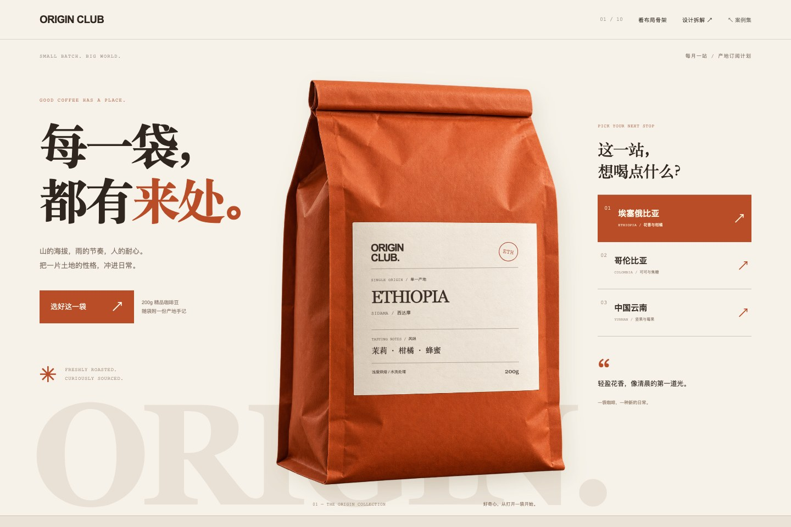

# 01 · 咖啡订阅 / 抄现实

每一袋，都有来处。



[打开网页](../examples/coffee-passport/index.html) · [完整长页](../previews/coffee-passport-full.jpg) · [手机截图](../previews/coffee-passport-mobile.png) · [布局骨架](../previews/coffee-passport-skeleton.jpg)

## 设计问题

原来的复杂山景与巨型杯体同时争抢注意，咖啡产品的质感和产地信息不够集中。新版围绕一袋真实包装组织信息，减少环境干扰。

## 构图与信息的关系

- **减法**：保留咖啡豆袋的卷口、侧褶与正面标签，去掉复杂环境。
- **分块**：品牌和产地代码进入标签顶部，国家与地区形成中心标题，风味与烘焙归入标签下部。右侧三站选择对应同一袋内的信息。
- **加法**：纸张摄影、少量烘焙橙和淡色大字建立质感。主标题与选择操作保持独立，避免所有信息挤入包装。

## 检查方法是否落实

切换产地会更新袋身上的国家、地区、风味和烘焙。图片上没有烘焙文字，标签内容由真实 HTML 呈现，可以选中与修改；布局骨架保留包装轮廓与标签分区。这个开关不代表无技能生成对照。

## 窄屏处理

标题、包装、产地选择依次排列。烘焙说明从包装小字移到袋下，手机端仍可读；同一字段随产地同步更新，包装不超出屏幕。

## 实现定位

- 网页源模板：`scripts/build-examples.py` 中的 `coffee-passport`。
- 专用样式：`docs/assets/coffee.css`；通用控件样式在 `docs/assets/shared.css`。
- 产地交互：`docs/assets/shared.js`。
- 原创包装图与完整生成提示词：[素材记录](../assets/art-prompts.json)。

## 独立复现用的场景简报

以下是后续复现的简报，不是本次迭代的逐字原始输入。

```text
用 $web-design-skill 的“抄现实”为咖啡订阅设计完整落地页。
以暖橙色纸质咖啡豆袋为现实载体，保留卷口和侧褶，产地、风味和烘焙进入袋身标签。
以暖白背景与深咖色大字建立层次，三个产地按钮更新标签。
手机端把烘焙细节移到袋下。主体摄影可生成，标题、产品信息和操作必须由 HTML 实现。
保留布局骨架开关，品牌与业务内容为虚构演示。
```

## 证据状态

这是根据用户反馈，在同一创作会话中重做的第三版咖啡案例。原来的山景与杯体已被包装方案替代。新包装图片使用内置 image_gen 生成，对成品质感有直接贡献。独立新会话复现与无技能盲评均未执行。

[实际网页验证记录](../verification.json) · [复现协议](../REPRODUCIBILITY.md) · [返回案例集](../index.html#cases)
