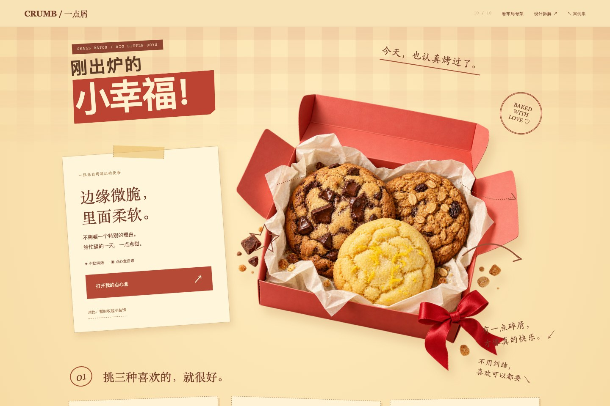

# 10 · 手作烘焙 / 钉钉铆铆

用小装饰，让一张目录有了人的语气。



[打开网页](../examples/crumb-bakery/index.html) · [完整长页](../previews/crumb-bakery-full.jpg) · [手机截图](../previews/crumb-bakery-mobile.png) · [布局骨架](../previews/crumb-bakery-skeleton.jpg)

## 设计问题

基础列表清楚，但少量散落圈线无法建立完整的手作气氛。

## 构图与信息的关系

在稳定的选择结构上添加胶带便条、红色邮戳、手绘箭头、口味序号、纸张角度和小字提示；原创新图承担食品质感，小装饰负责解释、引导与亲和。

- 装饰有具体信息职责
- 同一布局可切换细节
- 食品质感与手作语气统一

## 检查方法是否落实

口味数量与演示金额同步变化；“收起小装饰”可直接比较同一内容结构在细节上的变化。这个开关不是无技能生成对照。

## 窄屏处理

图像先行，便条与口味纸签依次排列；装饰避开文字与点击区域。

## 实现定位

- 方法条目：源仓库 `references/visual-methods.md` 第 10 节。
- 网页：`docs/examples/crumb-bakery/index.html`。
- 样式：`docs/assets/shared.css` 中标注为 10 的段落及响应式调整。
- 交互：`docs/assets/shared.js`。
- 图像素材与完整生成提示词：`docs/assets/art-prompts.json`。
- “布局骨架”只帮助检查当前设计结构，不代表未使用技能的对照实验。

## 独立复现用的场景简报

以下是后续复现的简报，不是本次迭代的逐字原始输入。

```text
用 $web-design-skill 的“钉钉铆铆”为手作烘焙制作完整的视觉专题。在稳定的选择结构上添加胶带便条、红色邮戳、手绘箭头、口味序号、纸张角度和小字提示；原创新图承担食品质感，小装饰负责解释、引导与亲和。 口味数量与演示金额同步变化；“收起小装饰”可直接比较同一内容结构在细节上的变化。这个开关不是无技能生成对照。 使用匹配的原创素材，真实文字与按钮由 HTML 呈现，加入可切换的布局骨架。品牌与业务内容均为概念演示。
```

## 证据状态

当前创作会话加载技能后制作，经过同一会话的视觉检查与修正。部分艺术素材使用内置 image_gen 生成；它们对成品表现有直接影响。独立新会话复现与无技能盲评均未执行。

[实际网页验证记录](../verification.json) · [复现协议](../REPRODUCIBILITY.md) · [返回案例集](../index.html#cases)
