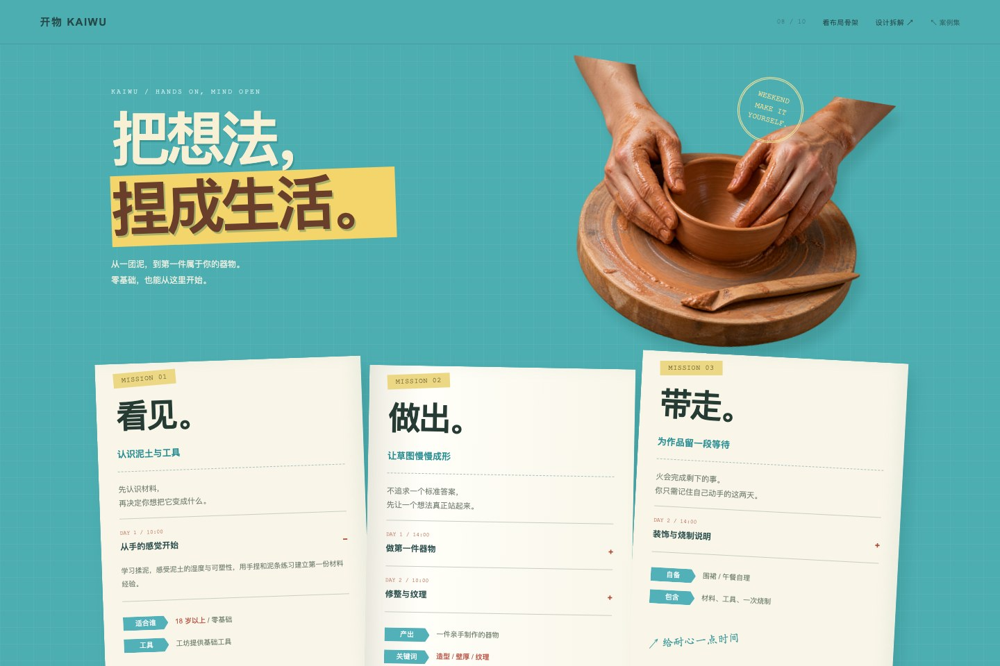

# 08 · 工作坊报名 / 文字衣橱

把长文案，折成一套能读懂的纸页。



[打开网页](../examples/kaiwu-workshop/index.html) · [完整长页](../previews/kaiwu-workshop-full.jpg) · [手机截图](../previews/kaiwu-workshop-mobile.png) · [布局骨架](../previews/kaiwu-workshop-skeleton.jpg)

## 设计问题

简单的课程列表与价格栏，不足以展现多类型信息的归纳能力。

## 构图与信息的关系

用三张折纸对应认识材料、制作器物、作品收尾三组任务。每页把主副标题、说明、日程、条件和提示定位；关键字段用统一标签，报名条件放在同一张底部票据。

- 大关系决定三折结构
- 同类字段形成视觉共性
- 关键信息独立定位

## 检查方法是否落实

四段日程可展开，场次选择生成摘要；同类字段在纸页中保持相同位置与形式。

## 窄屏处理

三折纸展开为三张纵向纸页，标签职责不变；报名票据变为纵向，完整保留条件。

## 实现定位

- 方法条目：源仓库 `references/visual-methods.md` 第 08 节。
- 网页：`docs/examples/kaiwu-workshop/index.html`。
- 样式：`docs/assets/shared.css` 中标注为 08 的段落及响应式调整。
- 交互：`docs/assets/shared.js`。
- 图像素材与完整生成提示词：`docs/assets/art-prompts.json`。
- “布局骨架”只帮助检查当前设计结构，不代表未使用技能的对照实验。

## 独立复现用的场景简报

以下是后续复现的简报，不是本次迭代的逐字原始输入。

```text
用 $web-design-skill 的“文字衣橱”为工作坊报名制作完整的视觉专题。用三张折纸对应认识材料、制作器物、作品收尾三组任务。每页把主副标题、说明、日程、条件和提示定位；关键字段用统一标签，报名条件放在同一张底部票据。 四段日程可展开，场次选择生成摘要；同类字段在纸页中保持相同位置与形式。 使用匹配的原创素材，真实文字与按钮由 HTML 呈现，加入可切换的布局骨架。品牌与业务内容均为概念演示。
```

## 证据状态

当前创作会话加载技能后制作，经过同一会话的视觉检查与修正。部分艺术素材使用内置 image_gen 生成；它们对成品表现有直接影响。独立新会话复现与无技能盲评均未执行。

[实际网页验证记录](../verification.json) · [复现协议](../REPRODUCIBILITY.md) · [返回案例集](../index.html#cases)
