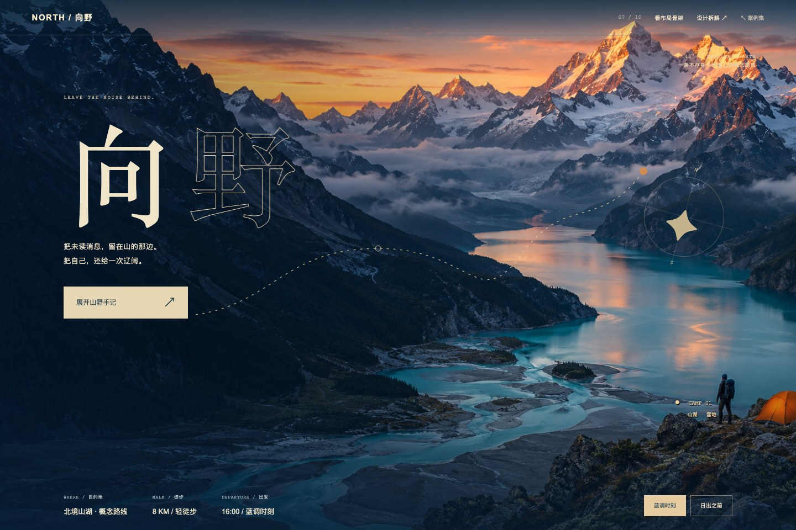

# 07 · 户外旅行 / 全屏大视野

把风景铺开，把内容稳稳放下。



[打开网页](../examples/north-travel/index.html) · [完整长页](../previews/north-travel-full.jpg) · [手机截图](../previews/north-travel-mobile.png) · [布局骨架](../previews/north-travel-skeleton.jpg)

## 设计问题

低细节矢量山景没有足够的场景张力，满屏也未形成沉浸感。

## 构图与信息的关系

用原创山湖影像贯穿全屏，把标题、行程与行动放进独立信息层；视觉路径、营地和罗盘与环境关联，边缘画面可以延展。

- 全幅影像建立空间
- 信息区独立于背景
- 主体与可裁切范围分开

## 交互与细节

切换时段更新图像调性与行程；骨架高亮文字安全区，验证信息不依赖背景图片内的文字。

## 窄屏处理

为窄屏重新取景与排列信息，核心标题、距离、出发时间与按钮保持独立。

## 试用提示词

可按你的产品、文案和素材调整：

```text
用 $web-design-skill 的“全屏大视野”为户外旅行制作完整的视觉专题。用原创山湖影像贯穿全屏，把标题、行程与行动放进独立信息层；视觉路径、营地和罗盘与环境关联，边缘画面可以延展。 切换时段更新图像调性与行程；骨架高亮文字安全区，验证信息不依赖背景图片内的文字。 使用匹配的原创素材，真实文字与按钮由 HTML 呈现，加入可切换的布局骨架。品牌与业务内容均为概念演示。
```

[返回案例集](../index.html#cases)
