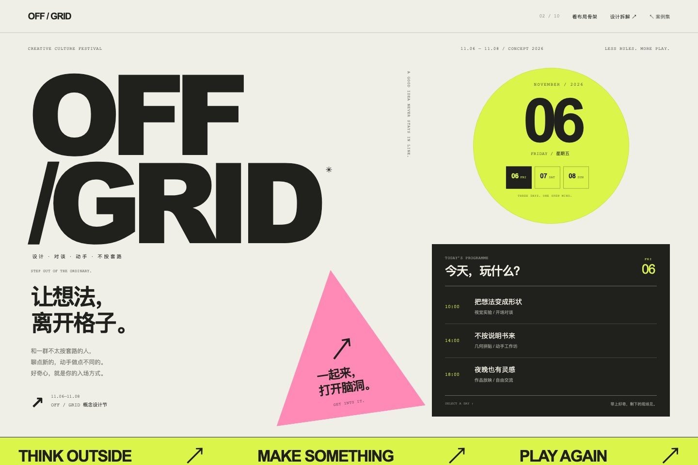

# 02 · 创意设计节 / 圆、方、三角

让想法，离开格子。



[打开网页](../examples/offgrid-festival/index.html) · [完整长页](../previews/offgrid-festival-full.jpg) · [手机截图](../previews/offgrid-festival-mobile.png) · [布局骨架](../previews/offgrid-festival-skeleton.jpg)

## 设计问题

此前的角色占据了大量空间，几何形状的功能与信息分工不够清楚。这次以当代设计节海报为方向，用大字和三个主形共同组织页面。

## 构图与信息的关系

- **圆**：荧光圆盘容纳日期、星期与三日选择。圆心的大号数字是当天议程的状态。
- **方**：黑色方块承载议程标题、日期角标、时间与活动；通过稳定的行列保证实际内容可读。
- **三角**：粉色三角本身是可点击、可键盘操作的入场说明按钮，朝向与箭头建立行动感。
- **整体**：大号 OFF / GRID 字样建立重心，圆、方、三角在同一画布中分配轻重，不依赖散落的小形状来解释方法。

## 检查方法是否落实

切换日期后，圆心数字、星期、方块角标与三条议程同步更新。三角按钮可通过点击和 Enter 打开入场说明，Escape 关闭。骨架开关用于查看当前成品的承载区，不代表无技能生成对照。

## 窄屏处理

标题和说明先行，圆盘与三角并置，再展开完整议程方块。重新排序后保留所有日期选择、九场活动与入场说明，不缩小整张桌面海报。

## 实现定位

- 源模板：`scripts/build-examples.py` 中的 `offgrid-festival`。
- 专用样式：`docs/assets/festival.css`；通用样式在 `docs/assets/shared.css`。
- 日期同步与对话框：`docs/assets/shared.js`。
- 本例主视觉由原生 HTML/CSS 几何与排版构成，没有新增图片素材。

## 独立复现用的场景简报

以下是后续复现的简报，不是本次迭代的逐字原始输入。

```text
用 $web-design-skill 的“圆、方、三角”为创意设计节制作海报式网页。
让大号 OFF / GRID 标题、荧光日期圆盘、黑色议程方块和粉色三角入场按钮组成完整构图。
圆盘内三个日期控制当天活动，日期和议程角标同步更新。
三角按钮提供可点击、可键盘操作的入场说明。
用 HTML/CSS 实现几何与文字，手机端重新排序，保留布局骨架。
品牌、日期和活动都是虚构演示。
```

## 证据状态

这是根据用户反馈，在同一创作会话中重做的第三版设计节案例。此前的角色方案已被几何海报方案替代。独立新会话复现与无技能盲评均未执行。

[实际网页验证记录](../verification.json) · [复现协议](../REPRODUCIBILITY.md) · [返回案例集](../index.html#cases)
